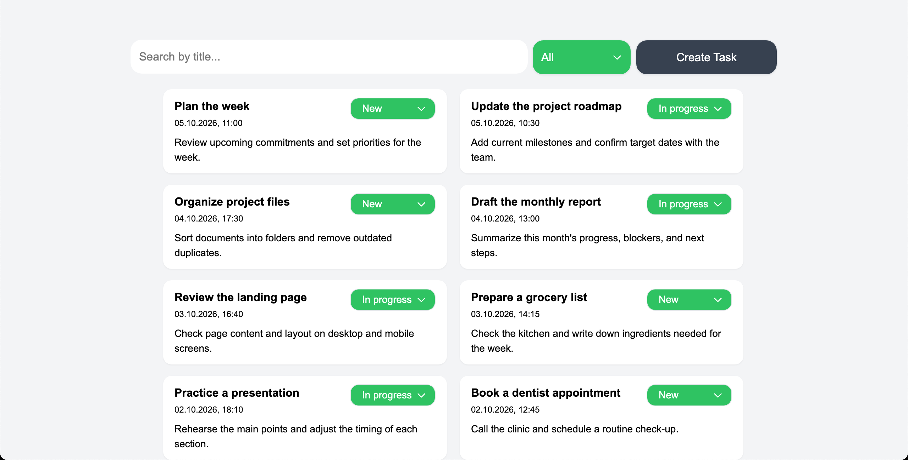
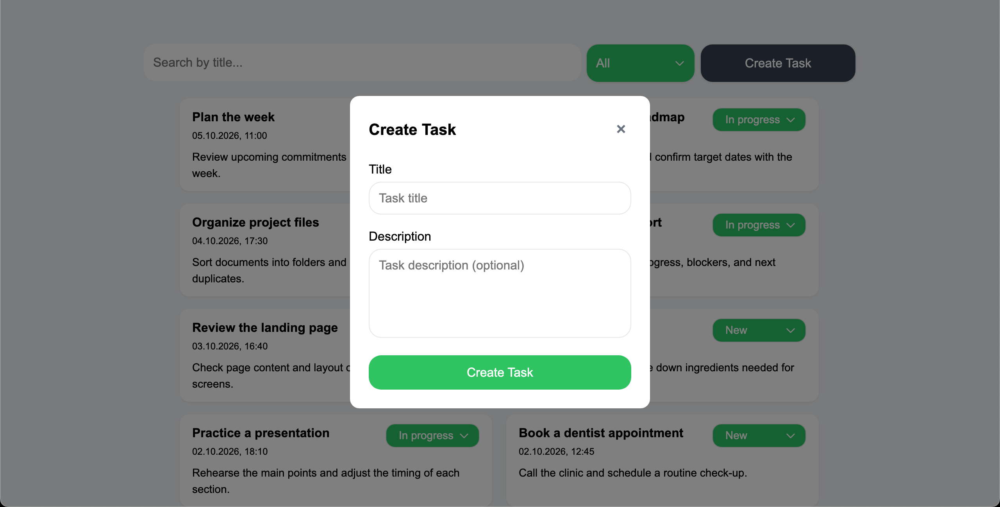

# Skyeng Assignment

## Установка
```bash
git clone https://github.com/mekanxsari/skyeng-assignment.git
cd skyeng-assignment
npm ci
```

Запустите локальный API и приложение в отдельных терминалах:

```bash
npm run api
```

```bash
npm start
```

Откройте http://localhost:4200

## Решения и компромиссы
- Список задач загружается с учётом выбранного статуса и поискового запроса. Для обновления данных используются `combineLatest` и `switchMap` из RxJS, а поиск запускается с `debounce`, чтобы не отправлять запрос на каждое нажатие клавиши.
- Данные задач, состояние загрузки и обновления хранятся в компоненте `task-list`, выбранный фильтр и поисковый запрос в `tasks-page`.
- При ошибке загрузки или сохранения показывается уведомление. Если не удалось изменить статус задачи, интерфейс возвращает прежний статус, список можно загрузить повторно кнопкой "Try again".
- Новая задача создаётся со статусом "Новая". Если выбран фильтр, который её не включает, модальное окно закрывается и появляется уведомление, но сама задача в текущем списке не отображается.
- В задании порядок сортировки не был уточнён, поэтому задачи сортируются по дате создания, сначала показываются самые новые.


## Что дальше
- Если бы у меня было больше времени, я бы добавил бесконечную прокрутку или постраничную загрузку задач.
- Ещё одно возможное улучшение: заменить фильтр на доску из трёх колонок по статусам и добавить перетаскивание задач между ними. Так управлять задачами было бы нагляднее и удобнее.


## Использование ИИ
У меня уже был опыт работы с React, поэтому я думал, что быстро освою Angular, но между ними оказалось много различий. ИИ помогал мне разбираться в Angular и исправлять ошибки в функциях. Сначала я оформил проект с помощью Tailwind, но позже выяснил, что нужно использовать обычный CSS. С помощью ИИ я заменил Tailwind-стили на CSS.
PS: Я не отправлял изменения в репозиторий небольшими порциями по ходу работы, потому что не заметил это требование. sorry :(

## Сколько времени заняло 
На то, чтобы разобраться, как работает Angular, у меня ушло примерно 8–10 часов. Ещё около 10–15 часов заняла разработка проекта.

## Скриншоты

